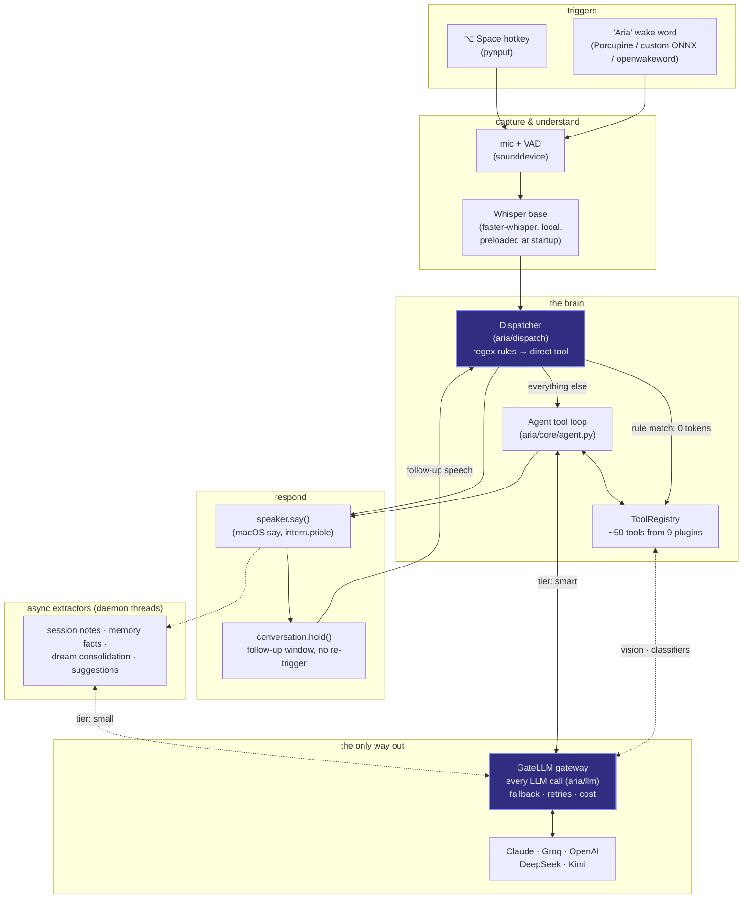
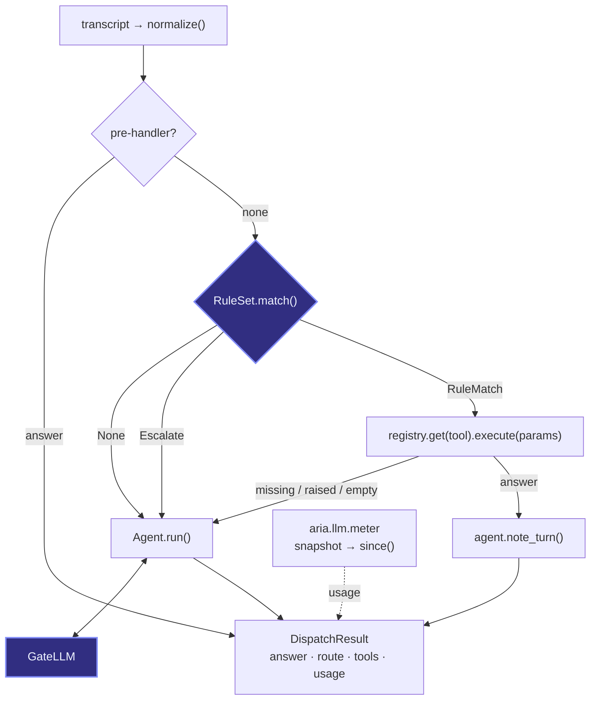
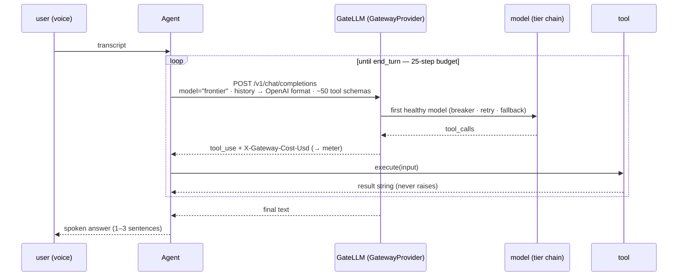
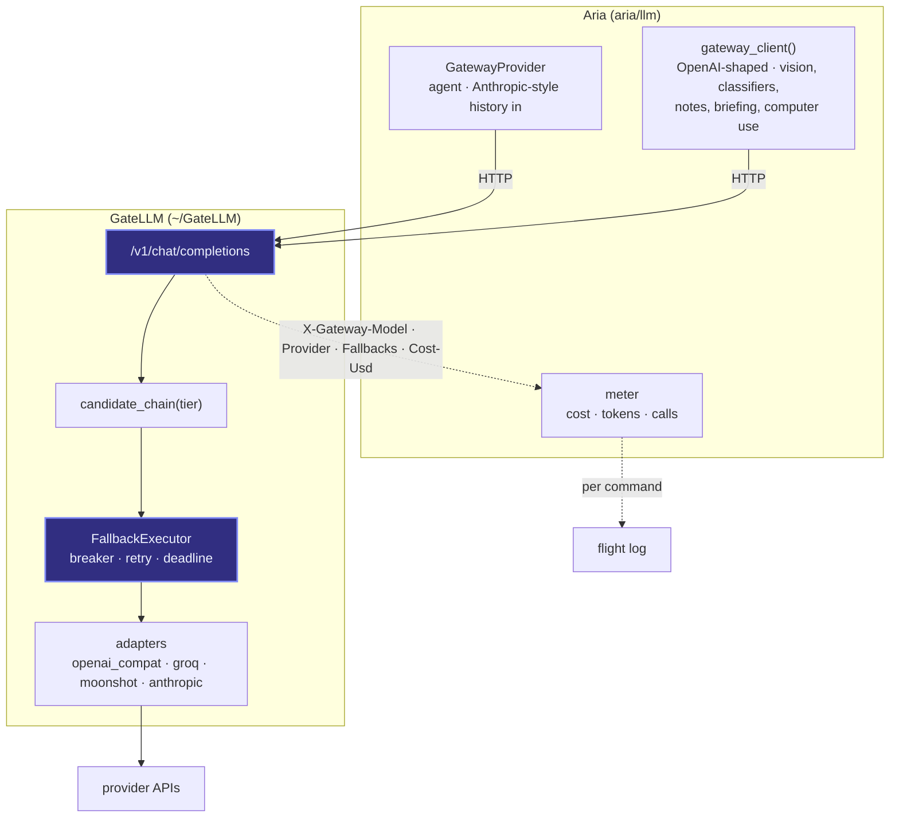
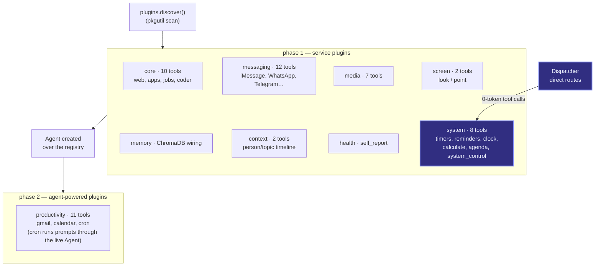
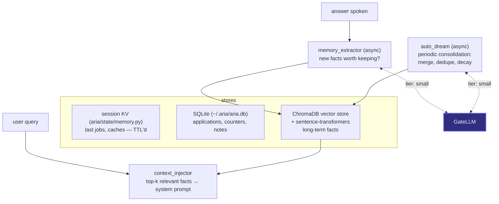
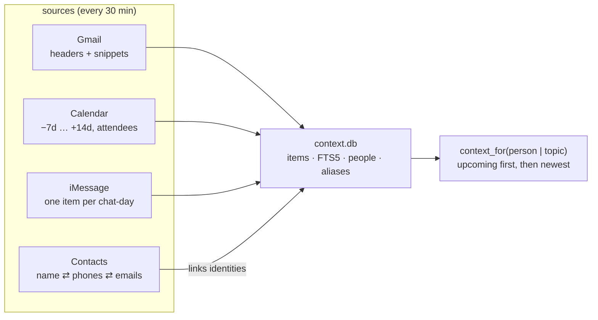
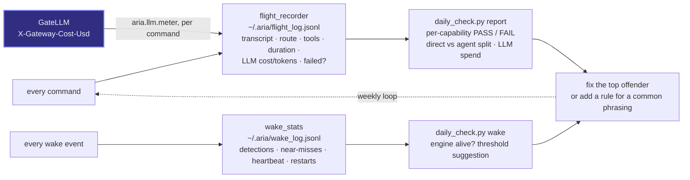
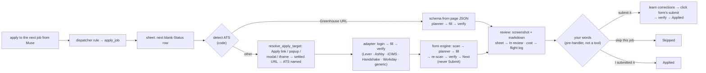
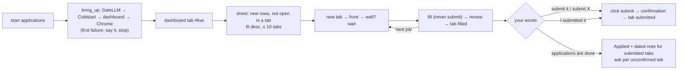

# Aria Architecture

Aria is a **background voice agent for macOS**: hotkey or wake word → speech → a
tool-using LLM agent → spoken answer. Search and page reading run headless, Aria's
own overlays never take focus, and the whole loop runs while you keep working.

Three ideas shape everything below:

1. **One path, many hands.** Every command goes through one dispatcher: strict
   regex rules run on-device commands (timers, reminders, volume, apps…) straight
   on a tool with zero LLM tokens; everything else goes to a single tool-loop
   Agent. ~50 tools across 9 drop-in plugins act, and both paths call the same
   tools. Every LLM call, with no exceptions, goes out through GateLLM (see
   [Design invariants](#design-invariants)).
2. **The user is never left guessing.** Every state Aria can be in is visible
   (menubar + on-screen HUD) or audible (chime, no-speech cue, "one moment").
3. **It measures itself.** Every command and every wake-word event is logged
   locally; a daily checklist turns those logs into a per-capability
   pass/fail report. Reliability work is driven by data, not vibes.

---

## The command lifecycle



A follow-up spoken into the `conversation.hold()` window goes straight back
through the dispatcher **with full cross-turn history** — "what about tomorrow?"
just works, no hotkey, no wake word. Direct-route turns are written into the
Agent's history too, so "turn it back on" after "pause the music" has context.

## The dispatcher: one path, cheapest first

`aria/dispatch/` is the single entry point (`Dispatcher.handle()`), modeled on
the regex fast path in front of Siri's LLM planner:

1. **Pre-handlers** — app-specific intercepts (jobs follow-ups).
2. **Direct routes** — `patterns.json`: whole-command regexes with typed slots
   (`duration`, `when`, `task_when`, `int`) mapped to a tool and its params.
   Parsers raise rather than guess; precision over recall.
3. **Agent** — everything else, plus any direct route whose slot doesn't parse
   or whose tool is unavailable or raises.

The agent is the understanding layer; regex routes are only a zero-token speed-up, and
nothing is reachable *only* through an exact phrase. `parse.normalize` drops spoken lead-ins
("yeah, …", "so, …") and a wake word Whisper glued on ("AriaHeadSubmit"); tools resolve
misheard names against their own data (`sheets.find_jobs`: fuzzy, never acting on a
sound-alike without asking). Measured on real utterances: `tests/data/intent_cases.json`
(offline: `tests/test_intent_cases.py`; live agent: `scripts/manual_intent_eval.py`, 13/13 on
2026-10-23). Every sentence Aria trips on becomes a new case.



The flight log records the route and LLM spend for every command;
`daily_check.py report` prints the direct/agent split. `ARIA_FASTPATH=0`
sends everything to the Agent.

## The Agent: one loop

`aria/core/agent.py` is ~250 lines and is the only decision-maker. Each turn:



- **History compaction** keeps multi-turn sessions inside the context window.
- **Memory injection**: relevant facts from the vector store are prepended to
  the system prompt per query (`aria/plugins/memory/context_injector.py`).
- **Failure discipline**: a tool that throws becomes a readable error string in
  the transcript; the model gets a chance to recover, and `Agent.run()` itself
  can never raise into the voice loop.

### LLM tiers via GateLLM (`aria/llm/`)

Every completion names a **task**. `TASK_TIERS` (`aria/llm/tasks.py`) maps the
task to a GateLLM tier, and GateLLM owns the provider chain (fallback, retries,
model quirks, pricing):



Failure behavior is explicit. Connection refused raises `GatewayUnavailable`, and
the agent speaks "I can't reach the LLM gateway". An HTTP error raises
`GatewayError`. There is no direct-provider fallback in Aria.

| GateLLM tier | chain (in GateLLM config.yaml) | tasks (examples from `TASK_TIERS`) |
|---|---|---|
| `frontier` | Claude Sonnet → GPT → Kimi → GPT-OSS 120B | `agent`, `coder`, `form_free_text` |
| `small` | GPT-OSS 120B (Groq) → DeepSeek → GPT mini → Claude Haiku | `form_short_answer`, `job_query_parse`, extractors, summaries |
| `vision` | Qwen3.8-27B (Groq) → Claude Haiku → Claude Sonnet | `screen_qa`, `page_vision`, `browser_vision_decide` |

Agent-style calls use `llm_client.complete(…, task="…")`. Modules that build
OpenAI-format messages (vision, classifiers, computer use) use
`gateway_client().chat.completions.create(model=tier_for("…"), …)`. Where a small
answer can be checked in code, `llm_client.complete_checked` validates it and
escalates once to frontier. Every call
is tallied in `aria.llm.meter`; the dispatcher snapshots it per command, so the
flight log's cost covers LLM calls made inside tools too.

## Plugins: drop a folder in, get capabilities

A plugin is a folder under `aria/plugins/` whose `__init__.py` defines a
`PluginBase` subclass. **That's the entire contract.** `plugins.discover()`
finds it at startup — no imports to add, no registration list to edit, and a
broken plugin is skipped with a log line instead of taking Aria down.



A minimal plugin:

```python
# aria/plugins/hue/__init__.py
from aria.core.plugin import PluginBase
from aria.core.tool import ToolDescriptor, ToolRegistry

class HuePlugin(PluginBase):
    def register(self, registry: ToolRegistry) -> None:
        registry.register(ToolDescriptor(
            name="lights_set",
            description="Set the room lights: on, off, or a brightness 0-100.",
            input_schema={"type": "object",
                          "properties": {"level": {"type": "string"}},
                          "required": ["level"]},
            execute=lambda p: _set_lights(p["level"]),
        ))
```

Restart Aria; the Agent can now control your lights. Plugins that need shared
services (browser, speaker, the Agent itself) override `from_context()` and
declare `requires_agent = True` to load in phase 2.

## Memory: four layers, one assistant that remembers



Tell Aria your favorite coffee once; it's embedded, consolidated during
"dreams," and injected into context whenever coffee comes up — this session or
next month.

## Context layer: one timeline across every app

Tools reach apps one at a time; the context layer is what *connects* them.
`aria/plugins/context/` keeps a local index (`~/.aria/context.db`, SQLite +
FTS5) of Gmail, Calendar and iMessage, and links every handle a person uses —
work email, phone number, display name — to one identity via macOS Contacts,
email headers and calendar attendees.



"What's going on with Priya?" is **one** `context_for` call that returns her
emails, texts and next meeting together. Without it, the Agent makes three
separate reads and has to work out by itself that `+1 555…` and
`priya@acme.com` are the same person. Name matching tolerates voice-transcript
misspellings ("Pria"), single first names never merge two people, and a fuzzy
name match loses to a real topic match ("Macro" ≠ "Marco"). The index stays on
the machine; only what the Agent reads goes to the LLM.

## Feedback: nothing happens silently

| you experience | source |
|---|---|
| pulsing pill at screen bottom whenever the mic is open | `aria/ui/listening_indicator.py` (click-through, never takes focus) |
| Glass chime on wake, Basso thunk if it woke but heard nothing | `aria/voice/wake_word.py` |
| soft pop when the follow-up window opens, "Anytime." on thanks | `aria/voice/conversation.py` |
| "One moment." when a turn runs past 3.5 s | `aria.voice.speaker.ThinkingAck` |
| menubar ◉ → 🎙 → ⏳ → ✓ | `aria/ui/menubar.py` (rumps) |

## Observability: the assistant that files its own bug reports

Two local-only JSONL logs, one report tool:



- `daily_check.py list --core` — a ~3-minute spoken checklist covering every
  capability.
- `daily_check.py report` — matches the flight log against that checklist:
  what passed, what failed, what the mic actually heard, which tool broke.
- `daily_check.py wake` — is the wake engine alive, how many near-misses, and
  a data-driven threshold suggestion when misses outnumber hits.
- Ask Aria herself: *"how have you been performing?"* (health plugin reads the
  same log).

The wake-word listener runs under a supervisor loop: crashes restart with
exponential backoff and are logged — it cannot die silently.

## Operating rules: the job pipeline and everything after it

These rules govern the job-application work and every later phase. They live
here so the code can be checked against them.

### The full loop

| # | Step | Owner | Status |
|---|---|---|---|
| 1 | Muse writes job rows to the sheet (`Sheet1`; blank Status = new) | Muse | in use |
| 2 | Find the people behind a posting: posting → team pages → search results → GitHub org | Aria | built (`aria/features/outreach`) |
| 3 | Find their emails, cache-first by company domain | Coldstart | built (called via its Python API) |
| 4 | Fill the application and **stop for the user's review** | Aria | built: Greenhouse adapter, DOM form engine (any other ATS) |
| 5 | Outreach: Gmail **drafts** (jobs account) or LinkedIn notes in the sheet. Aria never sends | Aria | built |
| 6 | Replies and bounces → Coldstart `record_feedback` | Aria | built |

Aria owns every runtime step. Claude is one model behind GateLLM, not a
component of the pipeline.

### Step 4 in detail: apply → review → submit



- `aria/features/applicator.py` is the single entry point. `aria/features/ats/` holds
  detection, `apply_target.py`, the adapters, the form engine, the shared planner, the two
  LLM tasks, the submit helper and the correction log.
- **Posting → form** (`apply_target.resolve_apply_target`, code only): an Apply *link* is
  followed in the same tab; an Apply *button* is clicked only on a page with no fields (it
  can't send anything), and its outcome is read: a new tab (the application's tab name moves
  to it; the posting tab stays open), a URL change, or a dialog. Redirects settle before the
  ATS is named from the final URL + DOM. Workday and Handshake pages are left to their
  adapters, which start the application themselves.
- **Adapters** (`ats/adapters/`): `detect / login / fill / verify` on a `Tab` handle (every
  page call is one short job on the browser worker). The base class is the generic adapter
  (the form engine); an ATS adapter adds its own pre-step and a `FIELD_KEYS` map from the
  ATS's stable field names / `data-automation-id`s to answer-bank keys, so those fields are
  filled by key whatever their label says. Lever → `/apply`, Ashby → `/application`, iCIMS →
  the frame's URL, Handshake → Apply, keep the resume already on the account (upload only
  when none is selected), stop at its dialog. Unknown ATS → the generic adapter.
- **Workday** (`adapters/workday.py`): a per-tenant state machine — Apply → "Use My Last
  Application" else "Apply Manually" → sign in with the tenant's Keychain login
  (`aria/system/keychain.py`, keyed by tenant host) or create an account with the application
  email + a generated password saved to the Keychain *before* the form is sent; the terms box
  is the user's to tick (once per tenant) → the verification code / link from the jobs Gmail,
  only when that account *is* the application email (`ats/email_code.py`) → the wizard. A
  rejected login, a missing email and a page Workday won't leave are handed to the user, with
  Workday's own error messages as the fields to answer. Passwords are typed straight into the
  page: never in a prompt, a log, a review row or a snapshot (password boxes aren't form
  fields, snapshots empty them).
- **Correction log** (`ats/corrections.py`, aria.db `apply_corrections`): every unknown ATS
  (its domain), missing Apply control, unmapped / failed field, failed login, wall and wall
  timeout, with the page saved to `~/.aria/corrections/` (owner-only).
  `python -m aria.features.ats.corrections --days 7` prints a batch grouped by kind.

### Form filling: code controls the flow, the LLM only writes

`planner.py` classifies every field by rules (upload · consent · fact · sensitive ·
choice · open_text) and decides its source; `form_engine.py` does the page work for
every non-Greenhouse form (Ashby, Lever, Jobvite, JazzHR …).

| Field | Filled from | If missing |
|---|---|---|
| fact (name, links, education, location) | answer bank | UNKNOWN → asked |
| sensitive (salary, sponsorship, work auth, EEO) | answer bank only, never guessed | UNKNOWN → asked |
| your preferences (offices, deadlines) | answer bank | UNKNOWN → asked |
| choice the bank doesn't cover | LLM picks an option from the resume | UNKNOWN → asked |
| open_text ("why us", "best project") | frontier LLM, resume + job, char limit kept | **never asked**; written again, else FAILED |
| upload | resume file (filename verified on the page) | asked |
| consent / agreement | the user ticks it when approving the submit | — |

The LLM's profile is the answer bank plus the resume's text (`resume_text.py`,
pdftotext). Generic open-text answers are saved in aria.db `generated_answers` and
reused on the same question; company-specific ones are rewritten. After every answer
the page is re-scanned for revealed fields; every value is read back and refilled up
to 2 times, then FAILED. Next / Continue is clicked only when the page verified and
nothing required is left; Submit never. A wall that appears mid-form (CAPTCHA, login,
an "I Accept / I Decline" privacy notice) is named by voice and a notification, and Aria
waits for the user without raising the tab, then carries on from the same step. Each application writes `~/.aria/reviews/<stem>.md` (summary: filled · unknown
· failed) and `<stem>.log.json` (every field: type, value, source, status).
`scripts/manual_fill_test.py` is the acceptance test on real postings.
- Every application gets its own visible tab (`aria/features/applying/tabs.py`
  registry, `~/.aria/apply_tabs.json`; the entry id is the `agent_browser` tab
  name), so other tools can't navigate it away while it waits for review.
- Submitting is never decided by an LLM. Exact phrases ("submit it") go to the dispatcher
  pre-handler (`aria/features/applying/commands.py`). Any other wording reaches the agent's
  `application_action` tool, which only *stages* submit / "I submitted" / close / mark
  Applied and reads it back ("Submit Software Engineer I at RTX?"); it runs only if the
  user's very next words are a yes, and it refuses if the tab isn't showing the reviewed form.
- Every job has a stable ID (`J0042`, an `ID` column in the jobs and Applied tabs,
  `sheets.ensure_ids`). Row numbers shift when rows are sorted or moved, so writes find the
  row by ID first. The user can name a job in any words and any order (`apply_job(job=…)`,
  `job_find`).

### One browser, never in your way (standing rules, set by the user 2026-10-22)

1. **Aria works in one browser: its own Chrome** (`aria/web/agent_browser.py`), like a
   browser agent working only in the tabs it was given. Every page Aria opens — "open
   YouTube", a scene's URL, a coder preview, a job listing, vision lookups — is a tab
   there (`browser.goto` → `agent_browser.open_in_tab`), never the user's default browser.
2. **It never takes focus.** New tabs are created in the background (CDP
   `Target.createTarget(background=true)`; Playwright's `new_page()` raised the window),
   Chrome is launched with `open -g`, and nothing raises the window — no walls, no run
   start, not even "open my dashboard". macOS never jumps out of a full-screen app. The
   window is always there to click on.
3. **The screen is read only when asked.** Whole-screen captures (screen_look /
   screen_point, the app-control screen read, a saved screenshot) check the words of
   the command being handled (`aria/screen/consent.py`, set by the dispatcher) and refuse
   unless they ask about the screen ("what's on my screen", "this error", "highlighted").

### Applications in front (standing rules, non-negotiable)

Set by the user 2026-10-21. Code that touches applications is checked against these.

1. **Starts only when asked, by voice.** Launching Aria (Aria.app, `main.py`,
   `python -m aria start`) never opens the dashboard or starts applications. Saying
   "let's apply to some jobs" / "start applications" brings up GateLLM, Coldstart
   (a library: import check), the dashboard and Aria's Chrome, health-checking each
   in that order. The first failure is named and nothing else starts. Then the
   dashboard opens in a background tab on Live run. The run speaks only for a wall
   (CAPTCHA / login / privacy notice), and once when finished, saying how many answers
   are missing from the answer bank. Progress goes to the terminal/log.
2. **Applications run in front, never in the background.** Every form fill happens
   in a visible, headed Chrome window. No headless mode for applications, ever.
   Each application opens in its own new tab — in the background: Aria's Chrome never
   takes focus (see "One browser, never in your way"). Aria never closes an application tab:
   only "close it" (the tab in front / "close <company>") or "close all" do.
   Background is fine for everything else (Gmail, contacts, Coldstart, sheet reads).
3. **Submitting** happens only on the user's words; Aria never clicks submit by
   itself. Each tab's state is tracked: `filling` → `filled` → `submitted`
   (confirmation page seen, or the user said "I submitted it"); `open` = the fill
   didn't finish; `closed` = the user closed it.
4. **"Applications are done"** marks the sheet Status = Applied, with a dated
   Updates note, for every tab where a confirmation page was seen or the user said
   "I submitted it". Every tab that's filled but not confirmed is asked about one at
   a time ("applied" / "not applied"); never marked Applied on a guess. Tabs stay open.
   The user can also say it directly at any time: "mark it / row 19 / John Deere as
   applied" (or not applied / skipped) writes that Status now — "it" is the tab in
   front, else the job Aria last filled. The agent's `job_status` tool can set every
   status except Applied, and the sheet is never edited by driving Google Sheets in the browser.
5. **Dashboard.** The Live run tab shows each open application tab: company, role,
   state, fields needing the user (`/api/runs` → `apps`). The Sheet tab is the Muse
   sheet itself (jobs + Applied tabs): read when first opened and on Refresh (never on a timer), any cell
   editable (Status as a dropdown), plus a Refresh button. Choosing Applied on the Jobs
   tab moves the row to the Applied tab (columns matched by name; added there first, then
   removed from Jobs). One cell per write through the Sheets API, found
   again by company + role and refused if the sheet changed since the page showed it.
6. **Tabs and control.** One persistent Chrome profile (`~/.aria/browser_profile`,
   the user's logins). Aria launches that Chrome detached with a 127.0.0.1 debug
   port and drives it over CDP, so tabs survive an Aria restart and are re-attached
   by URL on start. One job at a time, fit-score order (fit desc, then row). "Submit
   it" = the tab in front, "submit <company>" = that tab, unclear → ask. "Pause"
   holds before the next browser call (between fields); "stop" ends the run, tabs
   stay open. CAPTCHA (a *visible* challenge), login wall or email code → Aria says
   which company's tab needs it and waits; the tab is not raised — the user switches
   to Aria's Chrome when ready. Jobs already Applied or already open in
   a tab are skipped. At most 10 open application tabs. `caffeinate` for the whole run.



Known limit: Chrome only allows a debug port on a non-default profile, so this is
Aria's own profile, not the user's everyday Chrome. Any local process can reach that
port while Chrome runs.
- Every step writes `aria.db.application_runs` and a flight-log job entry with
  that job's LLM cost, keyed by sheet row. `daily_check.py report` prints
  per-row spend.

### Steps 2, 3, 5, 6 in detail: outreach

`aria/features/outreach/pipeline.py` is the entry point ("do my outreach", the
`job_outreach` tool, or `python -m aria.features.outreach`).

- **Which rows:** fit ≥ 3, open Status, empty outreach column, and nobody named in
  "Who to contact". Rows are grouped by company, so **one company gets one
  outreach**: the highest-fit row carries it and names every role, and sibling rows
  get "Outreach via row N". A company is skipped if any of its rows already shows
  outreach or a contact the user named.
- **People** (`contacts.py`, code only): the posting, the company's team pages
  (robots.txt respected), LinkedIn search results ("Name - Title - Company"), and the
  GitHub org's public members. Ranked by title keywords: recruiters, then
  engineering leaders, founders, engineers. The top 3 go to "Who to contact".
- **Channel** (`channel.py`, code only): Coldstart `find_emails`, then
  `recommend_channel`. Email when the address is verified, published, or a
  catch-all/unknown guess at ≥ 0.8 confidence; otherwise LinkedIn.
- **Writing** (`writer.py`): the frontier tier writes only the body. Code adds the
  greeting, the `<Role> — <Name>` subject (the dashboard links threads with it), the
  sign-off and the length checks. Email → jobs-Gmail draft; LinkedIn → a ≤ 300-char
  note in the outreach column, listed on the dashboard's Today tab.
- **Feedback** (`feedback.py`): each run first records new replies and bounces in the
  jobs Gmail with Coldstart. An outcome Coldstart already has is skipped.
- **Dry run:** everything runs except the writes (drafts, sheet, feedback); a report
  goes to `~/.aria/outreach/`.

### Storage split

| Store | Holds | Never holds |
|---|---|---|
| Google Sheet | the user's view: Status, Who to contact, Outreach, Updates | caches, logs |
| Coldstart SQLite | contact cache, email pattern per domain, verification results | application state |
| Aria `~/.aria/aria.db` | applications log, learned form answers (`learned_answers`), run and cost history | contacts |

Data is not duplicated across stores. Only what the user needs to see is synced
into the sheet. The hand-written answer seed (`~/.aria/answer_bank.json`) is
input that the user edits; anything Aria learns goes to `aria.db`.

### Code first, LLMs write and judge

Code finds, parses and fills. These are pure code with no LLM: sheet
read/write, dedupe, status, URL → domain, ATS detection, Greenhouse standard
fields, answer-bank lookups, the salary rule, dates, regex parsing of
"Name - Title - Company | LinkedIn" titles, title-keyword contact ranking, email
permutations, MX/SMTP checks, caching, reply detection and follow-up timing.

An LLM is allowed only for:
- **small:** picking an option for a background choice question from the resume; parse/rank fallbacks when regex fails or ties; reply classification
- **frontier:** every open-text form answer, from the resume; outreach emails
- **vision:** only when the DOM fails

Legal and personal facts (sponsorship, work authorization, demographics,
preferences, agreements and consents) are never guessed. An unanswered one is left
empty and flagged `needs_me` (UNKNOWN). Open-text questions are never flagged
`needs_me`.

### Model routing

- No LLM call decides routing. Each call site names a **task**, and
  `TASK_TIERS` in `aria/llm/tasks.py` maps it to `small`, `frontier` or `vision`.
  That table is the one place to tune tiers. Guard tests fail the build if a call
  site hard-codes a tier or uses a task that isn't in the table.
- Escalation (`llm_client.complete_checked`): run the task's tier, validate the
  output in code (schema, non-empty, option in the allowed list, length), and on
  failure retry **once** on frontier. Escalations are counted in `aria.llm.meter`
  and land in the flight log.
- GateLLM only does fallback chains, retries and cost. Cost is logged per job,
  keyed by sheet row, to the flight log.

## Design invariants

These are enforced, not aspirational:

1. **Never steal focus.** Agent browser work runs through a single worker
   thread (`agent_browser.run()` / `navigate()`); on-screen surfaces
   (`aria/ui/overlay.py`, `aria/ui/listening_indicator.py`) are borderless, click-through, and
   shown with `orderFrontRegardless`.
2. **Never raise into the voice loop.** Every handler returns a graceful
   spoken fallback. `Agent.run()`, `conversation.hold()`, both loggers, and
   every plugin tool are exception-proof at their boundary.
3. **One brain, one path.** The old LLM intent classifier / planner stack
   (~2,100 lines) was deleted once the tool-loop Agent proved strictly better.
   The dispatcher is not a second brain: it only runs a tool when a strict rule
   matches with fully parsed slots, and calls the same tools the Agent does.
4. **Local-first, one way out.** Whisper, wake models, ChromaDB, both logs — all
   on-device. Only LLM completions leave the machine, and every one goes through
   GateLLM (`ARIA_GATEWAY_URL`, default `http://127.0.0.1:8000`): the agent via
   `GatewayProvider`, vision/classifiers/computer use via `gateway_client()`.
   Aria imports no provider SDK (guard test: `test_no_module_calls_a_provider_sdk_directly`).
   Gateway down → Aria says so; direct routes still work.
5. **Voice is the UI.** Answers are 1–3 spoken sentences; no markdown, no URL
   dumps. Long work is acknowledged out loud rather than silently spinning.
6. **Python 3.9 discipline.** `from __future__ import annotations` everywhere;
   no `str | None` at runtime.

## Repository map

Entry points live at the root; everything else is the `aria` package,
grouped by concern:

```
main.py                 launcher shim → aria.app (so `python main.py` works)
daily_check.py          reliability CLI (checklist · report · wake)
aria/
  app.py                wiring + command lifecycle (the only god allowed)
  setup.py              `python -m aria.setup google [--account jobs]`: one-time account setup
  dashboard/            `python -m aria.dashboard`: pipeline page on 127.0.0.1 —
                        sources (sheet · aria.db · reviews · Coldstart · Gmail, never written) ·
                        model (match by apply link else company+role; stage = furthest evidence) · render ·
                        today · answers · applications · health · tabs (Live run · Costs · Settings) ·
                        costs (GateLLM call log + flight log) · writers: settings (GateLLM .env keys +
                        config.yaml tiers, then reload) and answers (via features/answer_bank edits)
  core/                 agent.py (tool loop) · tool.py (registry) ·
                        plugin.py (contract) · compact.py · config.py · paths.py
  dispatch/             dispatcher · rules + patterns.json · parse (durations, times)
  llm/                  GateLLM client: GatewayProvider (agent) · gateway_client() · meter ·
                        autostart (start GateLLM on demand, stop when idle) ·
                        context (task / job / run labels → X-Gateway-* headers on every call) ·
                        tasks.py (TASK_TIERS: the only place tiers are chosen)
  integrations/         google_auth (personal + jobs OAuth tokens, never mixed; scope tracking) · sheets (job sheet)
  plugins/              drop-in capability packs (apply, core, context, media, messaging,
                        memory, productivity, screen, health, system)
  voice/                voice_capture · transcriber · speaker (+ThinkingAck) ·
                        hotkey · wake_word (3 backends, restart supervisor) ·
                        conversation (follow-up window) · voice_keyterms
  ui/                   menubar · overlay · listening_indicator (HUD) · notifier
  web/                  browser · agent_browser (single worker thread) ·
                        dom_browser · computer_use · websearch · vision
  screen/               screen_qa · selection — screen intelligence
  state/                memory · db · session_notes · memory_extractor ·
                        auto_dream · away_summary — the memory layers
  features/             applicator (apply → review → submit) · ats/ (detect · apply_target ·
                        adapters/ · form_engine · planner · greenhouse · answers · submit ·
                        email_code · corrections) · answer_bank · jobs · briefing · media ·
                        mac_controller · coder · scenes · summarizer · tips
  system/               sleep_guard · prevent_sleep · keychain (portal logins, per tenant host)
  observability/        flight_recorder · wake_stats · run_log (pipeline steps + pick reasons → Live run tab)
  skills/               legacy local skills (see project state)
training/               custom wake-word model pipeline (record → train → onnx)
tests/                  ~900 tests (no live network); tests/daily_questions.json drives the
                        daily voice checklist
```

## Testing strategy

- **Unit**: pure logic (VAD thresholds, end-phrase detection, report building,
  discovery ordering) — fast, no hardware.
- **Contract**: every tool returns a string and never raises; plugins load
  from a bare `PluginContext`.
- **On-device**: `tests/checklist.md` + the daily voice checklist exercise the
  real mic, TTS, screen permissions, and focus behavior — the things mocks
  can't prove.
- **Continuous**: normal daily use *is* the test run; the flight recorder
  scores it and `daily_check.py report` grades it.
