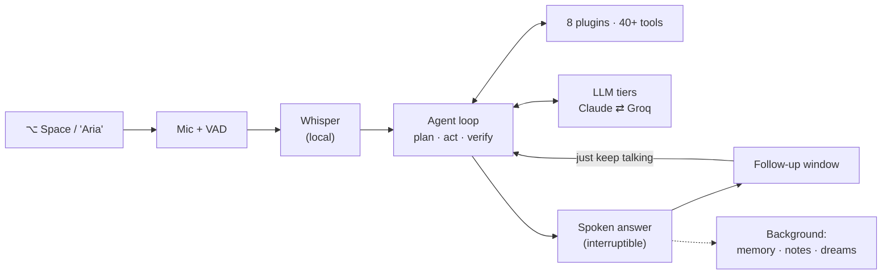
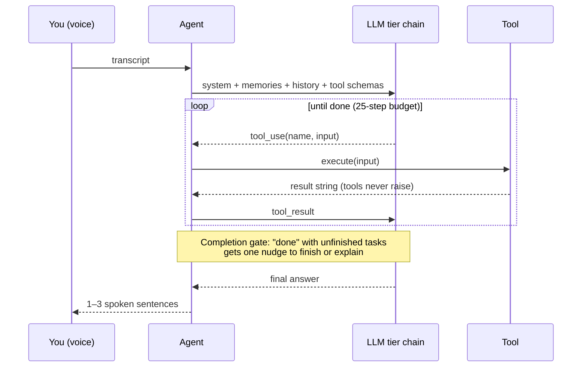
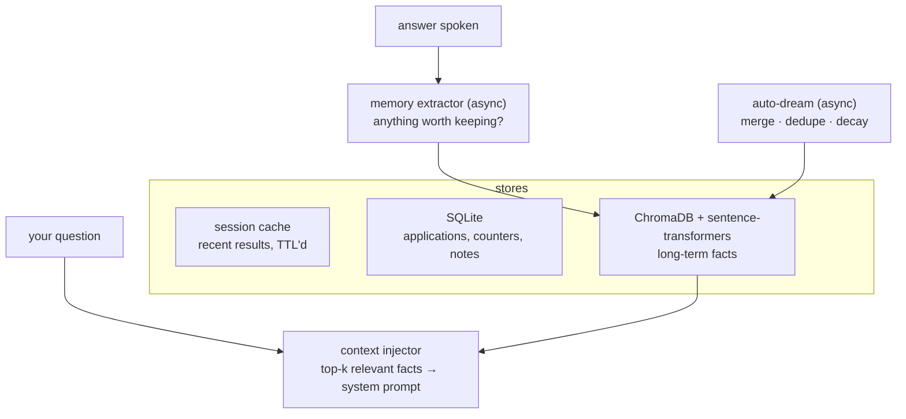
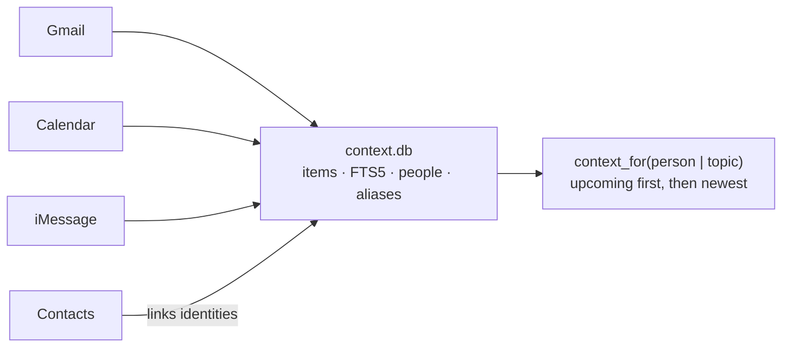
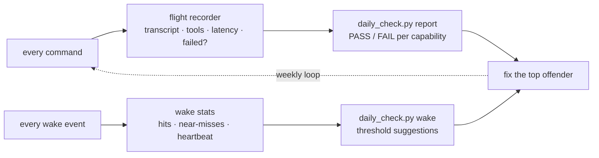

<div align="center">


**Hold ⌥ Space or just say "Aria", ask for something, and keep working.**
Aria plans, uses tools, browses, reads your mail and messages, controls your Mac, and answers out loud.

[How it works](#-how-a-command-flows) · [Architecture deep dive](ARCHITECTURE.md) · [Setup](#-setup) · [Run it](#-run)

</div>

```text
you:   "Aria, what's the weather right now?"
aria:  "It's 78 and sunny in Buffalo."               ← spoken, you never left your editor
you:   "what about tomorrow?"                         ← no hotkey: the mic reopened by itself
aria:  "Tomorrow looks like 81 with afternoon storms."
you:   "what's going on with Priya?"
aria:  "She emailed the Q3 deck this morning, texted that she's running late,
        and you have a 1:1 with her at 3."            ← email + iMessage + calendar, one answer
you:   "thanks"
aria:  "Anytime."
```

---

## ✨ At a glance

| | |
|---|---|
| 🧠 **One agent, no router** | A single tool-calling loop decides everything. The old 2,100-line intent classifier and planner were deleted once the agent proved strictly better. |
| 🧰 **40+ tools, 8 drop-in plugins** | Web, apps, media, screen, messaging, memory, productivity and cross-app context. Add a capability by dropping a folder in; no core edits. |
| 🔁 **Failover that survives mid-task** | Every call names a tier, not a model. If Claude runs out mid-run, Groq picks up the *same* tool history and finishes the job. |
| 🗂️ **Cross-app context** | One local index of Gmail, Calendar and iMessage, with each person's emails, numbers and names linked into one identity. |
| 💾 **Memory that consolidates** | Facts are extracted after each answer, stored as vectors, and periodically "dreamed" into cleaner long-term memory. |
| 📈 **It grades itself** | Every command is logged locally, and a daily checklist turns the log into a per-capability PASS / FAIL report. |
| 🔒 **Local-first** | Speech-to-text, wake word, memory, logs and the context index all stay on your Mac. Only LLM calls leave the machine. |

---

## 🔄 How a command flows



Here's what happens between "Aria" and the answer, one stage at a time.

### 1 · Listen: wake word and hotkey

Aria runs one of three wake-word engines, picked automatically: Porcupine, a **custom "Aria" model I trained and exported to ONNX** (the pipeline is in [`training/`](training/): record → augment → train → export), or openWakeWord. The listener runs under a restart supervisor with exponential backoff and writes a heartbeat, so it can't die silently. A global ⌥ Space hotkey works alongside it.

Every state is visible or audible: a chime on wake, a pulsing pill at the bottom of the screen while the mic is open, a low "thunk" if it woke but heard nothing, and ◉ → 🎙 → ⏳ → ✓ in the menu bar.

### 2 · Understand: local speech-to-text

Audio goes through voice-activity detection, then **faster-whisper runs on-device**. It's preloaded at startup so the first command doesn't pay the load time. Whisper is primed with domain keyterms (product names, your name and skills from your profile) so proper nouns come through spelled correctly.

### 3 · Think: one agent loop, no routing table

[`aria/core/agent.py`](aria/core/agent.py) is the only decision-maker. Each turn sends the transcript, conversation history, relevant memories and 40+ tool schemas to the LLM, then loops until the model is done:



Patterns adapted from how coding agents work:

- **Task list** (`update_tasks`): for multi-step goals the model writes and updates its own checklist, so it always sees what's left.
- **Completion gate**: if the model claims it's done while tasks are still open, the loop pushes back once instead of accepting a half-finished answer.
- **Sub-agents** (`run_subtask`): long research or web flows run in a fresh agent with its own history. The main conversation only pays for the summary.
- **History compaction**: long sessions get summarized at 80% of the context window, so conversations can run indefinitely.

### 4 · Act: drop-in plugins

A plugin is a folder in `aria/plugins/` with a `PluginBase` subclass. **That's the whole contract.** Plugins are discovered at startup, and a broken plugin is skipped with a log line instead of taking Aria down.

```python
# aria/plugins/hue/__init__.py
from aria.core.plugin import PluginBase
from aria.core.tool import ToolDescriptor, ToolRegistry

class HuePlugin(PluginBase):
    def register(self, registry: ToolRegistry) -> None:
        registry.register(ToolDescriptor(
            name="lights_set",
            description="Set the room lights: on, off, or a brightness 0-100.",
            input_schema={"type": "object",
                          "properties": {"level": {"type": "string"}},
                          "required": ["level"]},
            execute=lambda p: _set_lights(p["level"]),
        ))
```

Restart, and the agent can control your lights. Plugins that need the agent itself (like cron, which runs scheduled prompts through it) load in a second phase.

**Web browsing is DOM-first.** The agent gets a compact list of the page's clickable elements and picks one by text, which is fast and cheap. When a page exposes too few elements, it falls back to a screenshot and a vision model. All Playwright work runs on one dedicated worker thread behind a queue, so the hotkey, wake-word and agent threads never touch browser objects.

### 5 · Think again: LLM tiers with real failover

Every completion asks for a **tier**, not a model. Each tier is a chain that falls through on rate limits, auth errors, outages or an empty credit balance:

| Tier | Chain | Used for |
|---|---|---|
| `smart` | Claude Sonnet 4.6 → Claude Haiku 4.5 → GPT-OSS 120B (Groq) | the agent loop |
| `cheap` | Claude Haiku 4.5 → GPT-OSS 20B (Groq) | extractors, summaries |
| `fast` | GPT-OSS 20B (Groq) → Claude Haiku 4.5 | latency-sensitive helpers |

The hard part is the middle of a task. Claude's history is full of Anthropic-format `tool_use` / `tool_result` blocks that other providers reject, so the Groq adapter **translates the whole tool history to OpenAI format** on the fly. A run Claude started can be finished by Groq. Groq model IDs live in one file, overridable by env var, because Groq retires models with little notice.

**One provider going down costs quality, never availability.**

### 6 · Remember: four layers



Tell Aria your coffee order once. It's embedded, cleaned up during "dreams", and brought back into context whenever coffee comes up, this session or next month. All of it runs in background threads after the answer is spoken, so memory never adds latency.

### 7 · Connect: one timeline across your apps

Tools reach apps one at a time; the context layer connects them. [`aria/plugins/context/`](aria/plugins/context/) keeps a local SQLite + FTS5 index of Gmail, Calendar and iMessage, refreshed every 30 minutes. It links every handle a person uses (work email, phone number, display name) through macOS Contacts, email headers and calendar attendees.



"What's going on with Priya?" becomes **one** tool call instead of three, and the agent doesn't have to work out that `+1 555…` and `priya@acme.com` are the same person. Matching handles voice misspellings ("Pria"), never merges two people from a shared first name, and a real topic match beats a fuzzy name match. The index never leaves the machine.

### 8 · Respond and follow up

Answers are 1–3 spoken sentences: no markdown, no URL dumps. If a turn runs past 3.5 s, Aria says "One moment" so you're never left wondering. Speech is interruptible. After answering, the mic **reopens for a follow-up window**, and "what about tomorrow?" goes straight back into the agent with full history.

### 9 · Measure: the assistant that files its own bug reports



A 28-question, 17-category spoken checklist covers every capability. The report matches it against the flight log and shows what passed, what failed, what the mic actually heard, and which tool broke. You can also just ask: *"How have you been performing?"*

---

## 🧭 Design principles

These are enforced in code, not aspirations:

1. **Never raise into the voice loop.** Every tool returns a string. `Agent.run()`, the follow-up window, both loggers and every plugin boundary are exception-proof. A failure becomes a spoken explanation, never a crash.
2. **One brain.** No intent classifier, no routing table. Dead paths drift, and drift ships bugs.
3. **Nothing happens silently.** Every state has a visual or audible signal.
4. **Local-first.** Only LLM completions leave the machine.
5. **Voice is the UI.** Short spoken answers, and long work is acknowledged out loud.
6. **Measure, then fix.** Reliability work starts from the flight log, not guesses.

---

## 🛠️ What it can do

| | |
|---|---|
| **Converse** | Follow-ups without re-triggering, cross-turn memory, "one moment" while thinking |
| **Research the web** | Search and page reading run headless in the background; multi-step web tasks drive a dedicated Chrome profile |
| **See your screen** | "What's on my screen?", "explain this" on highlighted text, "show me where the save button is" (draws on screen) |
| **Control your Mac** | Open apps, media playback, volume and brightness, screenshots |
| **Message people** | iMessage and WhatsApp, always confirming before sending (Slack, Telegram and Discord are stubbed for later) |
| **Run your day** | Morning briefing, Gmail, Google Calendar, cron-scheduled prompts |
| **Know your people** | Cross-app timeline for any person or topic |
| **Job hunt** | Searches LinkedIn and Indeed, tracks applications, helps fill forms |
| **Remember** | Vector memory with periodic consolidation |
| **Write code** | Agentic coding tasks by voice |
| **Report on itself** | Reads its own flight log and tells you how it's doing |

---

## 🚀 Setup

Requires macOS, [Homebrew](https://brew.sh), Python 3.9+, Google Chrome, and `brew install ffmpeg`.

```bash
git clone https://github.com/Bhanu1299/Aria.git
cd Aria

python3 -m venv venv
source venv/bin/activate
pip install -r requirements.txt
playwright install chromium

cp .env.example .env                       # add ANTHROPIC_API_KEY and GROQ_API_KEY
cp identity.example.json identity.json     # your name and profile (stays local, gitignored)
```

**Permissions** (System Settings → Privacy & Security): **Microphone**, **Accessibility** (hotkey and app control), and optionally **Screen Recording** (screen questions) and **Full Disk Access** (iMessage and the context layer).

## ▶️ Run

**As a Mac app (recommended):**

```bash
venv/bin/python scripts/build_app.py               # builds and installs /Applications/Aria.app
venv/bin/python scripts/build_app.py --login-item  # ...and starts it at login
```

Aria.app lives in the menu bar only (no Dock icon), asks for permissions as **Aria** rather than your terminal, keeps a single instance running, and logs to `~/.aria/logs/aria.log` (menu bar → Show Log).

**From a terminal:**

```bash
source venv/bin/activate
python main.py
python main.py --login gmail      # one-time logins: gmail, google, linkedin
```

Hold **⌥ Space** and speak, or just say **"Aria"**.

**Reliability tools:**

```bash
python daily_check.py list --core   # ~3-minute spoken checklist
python daily_check.py report        # per-capability PASS / FAIL from the flight log
python daily_check.py wake          # is the wake engine healthy? threshold tips
```

---

## 🧱 Stack

| Layer | Tech |
|---|---|
| Speech-to-text | faster-whisper (base), fully local |
| Wake word | Porcupine · custom-trained ONNX · openWakeWord (auto-selected) |
| LLMs | Anthropic Claude + Groq, tiered failover chains |
| Browser | Playwright: headless fetcher + DOM-first agent browser on one worker thread, vision fallback |
| Memory | ChromaDB + sentence-transformers, SQLite, session cache |
| Context index | SQLite + FTS5, identities linked via macOS Contacts |
| Voice I/O | sounddevice, macOS `say` (interruptible) |
| UI | rumps menu bar, AppKit click-through overlays, native `.app` bundle |

## 🗺️ Repository map

```
main.py               launcher shim → aria.app
daily_check.py        reliability CLI (checklist · report · wake)
aria/
  app.py              wiring + command lifecycle
  core/               agent loop, tool registry, plugin contract, task list, sub-agents, compaction
  llm/                provider chains: Anthropic + Groq, tiered failover, model IDs
  plugins/            core · context · media · messaging · memory · productivity · screen · health
  voice/              capture, transcriber, speaker, hotkey, wake word, follow-up window
  web/                headless fetcher, agent browser, DOM-first computer use, search, vision
  screen/             screen Q&A, highlighted-text explanations
  state/              memory layers, session notes, extractors, auto-dream
  observability/      flight recorder, wake stats
  ui/                 menu bar, overlays, listening indicator
scripts/              Aria.app builder, VAD calibration
training/             custom wake-word pipeline (record → train → ONNX)
tests/                ~550 tests + the daily voice checklist
```

The full design, with more diagrams, is in **[ARCHITECTURE.md](ARCHITECTURE.md)**. Troubleshooting is in [HOW_TO_RUN.md](HOW_TO_RUN.md).

## 🧪 Testing

- **Unit:** pure logic such as VAD thresholds, end-phrase detection, provider message translation, identity linking and report building.
- **Contract:** every tool returns a string and never raises, and plugins load from a bare context.
- **Guard tests:** a scan that fails if any tool still uses pre-refactor imports.
- **On-device:** the daily voice checklist exercises the real mic, TTS, screen permissions and focus behavior, the things mocks can't prove.

```bash
venv/bin/python -m pytest -q --ignore=tests/test_transcriber.py \
  --ignore=tests/test_voice_capture.py --ignore=tests/test_speaker.py   # these need real audio hardware
```

## License

[MIT](LICENSE) © 2026 Bhanu Teja
