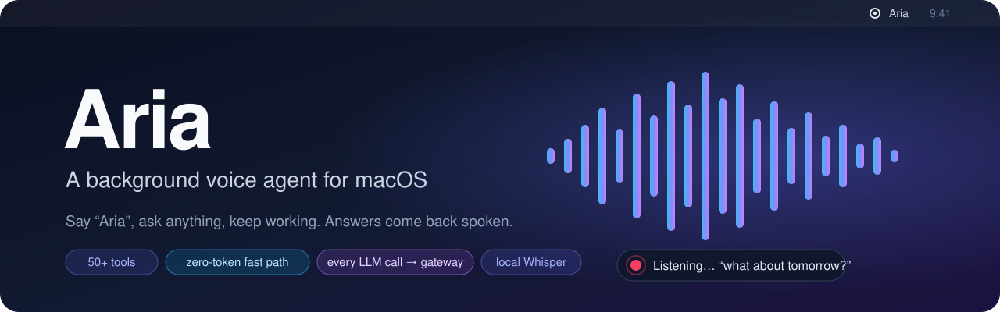
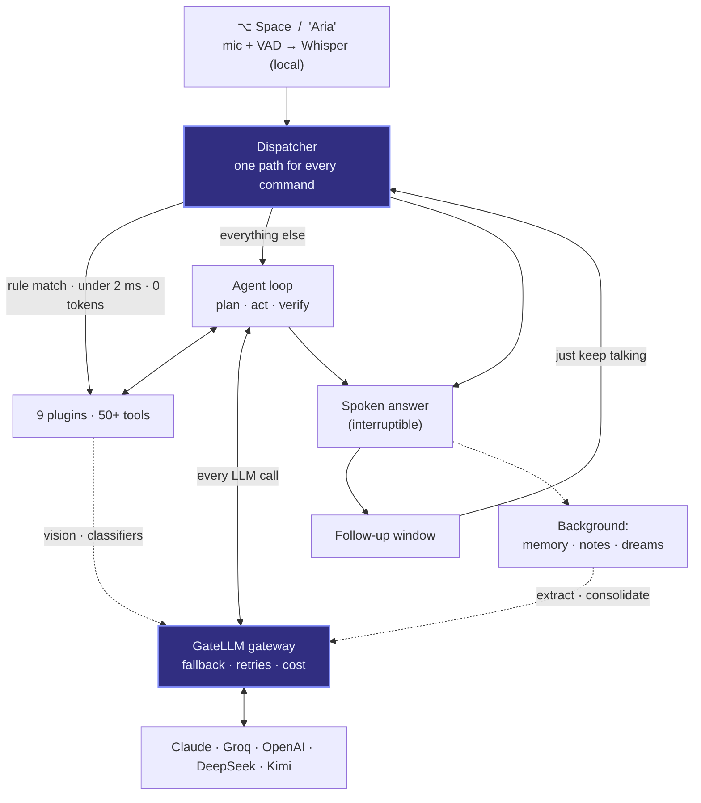
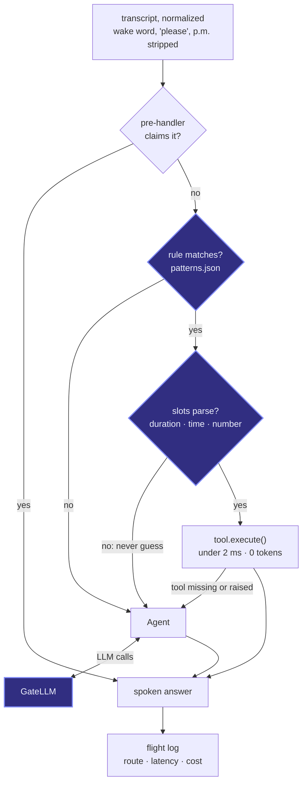
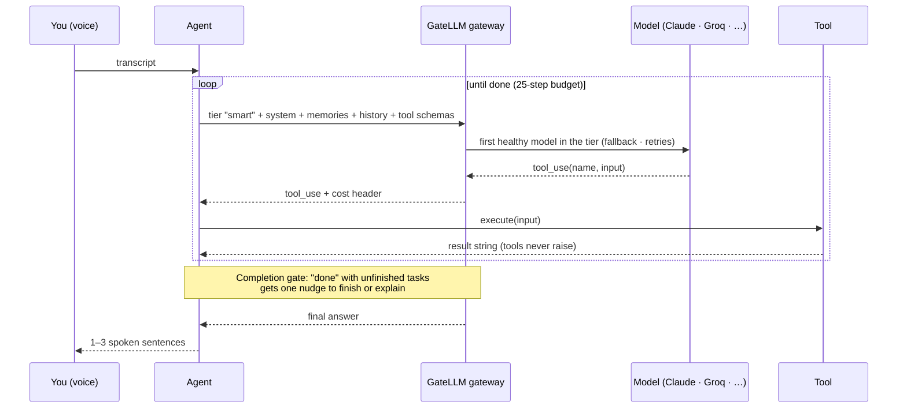
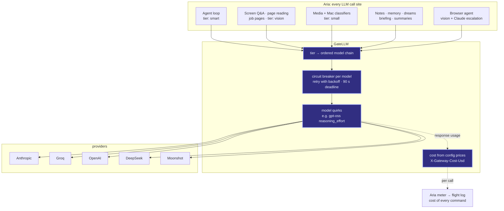
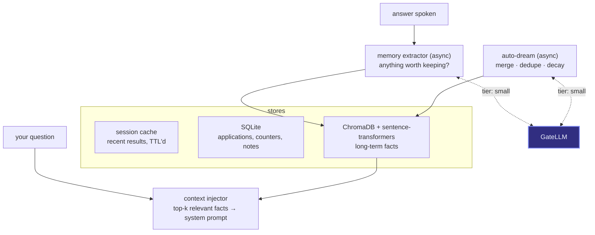
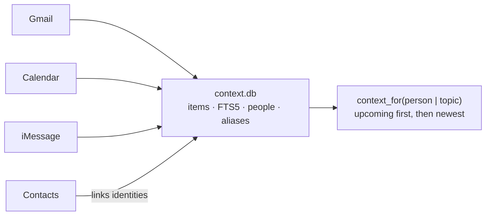
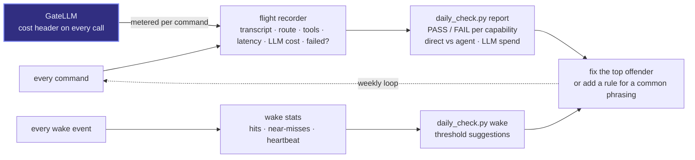
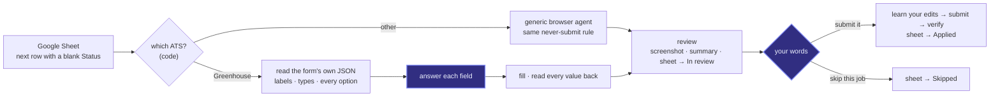

<div align="center">




**Hold ⌥ Space or just say "Aria", ask for something, and keep working.**
Aria plans, uses tools, browses, reads your mail and messages, controls your Mac, fills in job applications for your review, and answers out loud.

[How it works](#-how-a-command-flows) · [Job applications](#-job-applications-fill-stop-you-decide) · [Architecture deep dive](ARCHITECTURE.md) · [Setup](#-setup) · [Run it](#-run)

</div>

```text
you:   "Aria, what's the weather right now?"
aria:  "It's 78 and sunny in Buffalo."               ← spoken, you never left your editor
you:   "what about tomorrow?"                         ← no hotkey: the mic reopened by itself
aria:  "Tomorrow looks like 81 with afternoon storms."
you:   "what's going on with Priya?"
aria:  "She emailed the Q3 deck this morning, texted that she's running late,
        and you have a 1:1 with her at 3."            ← email + iMessage + calendar, one answer
you:   "remind me to send the deck tomorrow at 9"
aria:  "Okay, I'll remind you to send the deck tomorrow at 9 AM."
                                                      ← instant: no LLM call, zero tokens
you:   "thanks"
aria:  "Anytime."
```

---

## ✨ At a glance

| | |
|---|---|
| 💼 **Job applications that stop for review** | Say "apply to the next job" and Aria takes the next row from your job sheet, fills the Greenhouse form, and **stops**: you get a screenshot, a review of every field and where each answer came from, and a status update in the sheet. Nothing is submitted until you say "submit it". Visa, work-authorization and demographic questions are never guessed. [How it works](#-job-applications-fill-stop-you-decide) |
| 🧭 **Fast path before the LLM** | Timers, reminders, volume, apps and math answer in **under 2 ms with zero tokens**, instead of a 0.3–2 s model round trip. One dispatcher sends everything else to the agent, and both paths call the same tools. Modeled on how Siri routes requests, which I worked out from the files it ships. |
| 🚪 **One gateway, every LLM call** | Agent turns, vision, classifiers and browser automation all go through [GateLLM](#6--reach-the-llm-one-gateway-for-every-call), an LLM gateway I built as a separate project. It handles provider fallback, retries, model quirks and per-call cost, so Aria imports no provider SDK, and a test fails if one sneaks back in. |
| 🧰 **50+ tools, 9 drop-in plugins** | Web, apps, system, media, screen, messaging, memory, productivity and cross-app context. Add a capability by dropping a folder in; no core edits. |
| 🗂️ **Cross-app context** | One local index of Gmail, Calendar and iMessage, with each person's emails, numbers and names linked into one identity. |
| 💾 **Memory that consolidates** | Facts are extracted after each answer, stored as vectors, and periodically "dreamed" into cleaner long-term memory. |
| 📈 **It grades itself** | Every command is logged locally with its route and LLM cost, and a daily checklist turns the log into a per-capability PASS / FAIL report. |
| 🔒 **Local-first** | Speech-to-text, wake word, memory, logs and the context index all stay on your Mac. Only LLM calls leave the machine, all through one gateway. |

---

## 🔄 How a command flows



The two highlighted boxes are the backbone. Every command enters through the **dispatcher**, and every LLM call leaves through the **gateway**. Nothing in Aria talks to a model provider directly.

Here's what happens between "Aria" and the answer, one stage at a time.

### 1 · Listen: wake word and hotkey

Aria runs one of three wake-word engines, picked automatically: Porcupine, a **custom "Aria" model I trained and exported to ONNX** (the pipeline is in [`training/`](training/): record → augment → train → export), or openWakeWord. The listener runs under a restart supervisor with exponential backoff and writes a heartbeat, so it can't die silently. A global ⌥ Space hotkey works alongside it.

Every state is visible or audible: a chime on wake, a pulsing pill at the bottom of the screen while the mic is open, a low "thunk" if it woke but heard nothing, and ◉ → 🎙 → ⏳ → ✓ in the menu bar.

### 2 · Understand: local speech-to-text

Audio goes through voice-activity detection, then **faster-whisper runs on-device**. It's preloaded at startup so the first command doesn't pay the load time. Whisper is primed with domain keyterms (product names, your name and skills from your profile) so proper nouns come through spelled correctly.

### 3 · Route: one dispatcher, cheapest first

Sending "pause the music" to an LLM is slow and costs money. Before building this I went through the configs and string tables Siri ships on macOS. Its new LLM planner sits behind a regex classifier with 622 patterns, and common requests never reach the model. Aria does the same thing at a smaller scale.

Every command, whether it comes from the hotkey, the wake word or a follow-up, goes through [`Dispatcher.handle()`](aria/dispatch/dispatcher.py):



1. Pre-handlers catch app-specific follow-ups, like "tell me about the second job".
2. Direct routes come from [`patterns.json`](aria/dispatch/patterns.json): about 45 whole-sentence regexes with typed slots, each mapped to a tool. "Set a timer for an hour and a half" becomes `timer_set(seconds=5400)`. "Remind me to call mom at 5pm" becomes `reminder_add(task="call mom", due="…T17:00")`, with the date built from parts so it doesn't depend on locale. These run in under 2 ms and use no tokens.
3. Everything else goes to the agent.

The rules favor precision over recall. A missed rule costs nothing, because the agent still answers. A wrong match does the wrong thing, so the [slot parsers](aria/dispatch/parse.py) raise instead of guessing: "set a timer for a while" goes to the agent instead of turning into a made-up duration. 120 tests pin real phrasings to the tool each must reach, or to the agent, against a fixed clock. Direct turns are also written into the agent's history, so "turn it back on" after "pause the music" still works.

### 4 · Think: one agent loop

[`aria/core/agent.py`](aria/core/agent.py) handles every command that doesn't match a rule. Each turn sends the transcript, conversation history, relevant memories and 50+ tool schemas to the LLM, then loops until the model is done:



Patterns adapted from how coding agents work:

- **Task list** (`update_tasks`): for multi-step goals the model writes and updates its own checklist, so it always sees what's left.
- **Completion gate**: if the model claims it's done while tasks are still open, the loop pushes back once instead of accepting a half-finished answer.
- **Sub-agents** (`run_subtask`): long research or web flows run in a fresh agent with its own history. The main conversation only pays for the summary.
- **History compaction**: long sessions get summarized at 80% of the context window, so conversations can run indefinitely.

### 5 · Act: drop-in plugins

A plugin is a folder in `aria/plugins/` with a `PluginBase` subclass. **That's the whole contract.** Plugins are discovered at startup, and a broken plugin is skipped with a log line instead of taking Aria down.

```python
# aria/plugins/hue/__init__.py
from aria.core.plugin import PluginBase
from aria.core.tool import ToolDescriptor, ToolRegistry

class HuePlugin(PluginBase):
    def register(self, registry: ToolRegistry) -> None:
        registry.register(ToolDescriptor(
            name="lights_set",
            description="Set the room lights: on, off, or a brightness 0-100.",
            input_schema={"type": "object",
                          "properties": {"level": {"type": "string"}},
                          "required": ["level"]},
            execute=lambda p: _set_lights(p["level"]),
        ))
```

Restart, and the agent can control your lights. Plugins that need the agent itself (like cron, which runs scheduled prompts through it) load in a second phase.

**Web browsing is DOM-first.** The agent gets a compact list of the page's clickable elements and picks one by text, which is fast and cheap. When a page exposes too few elements, it falls back to a screenshot and a vision model. All Playwright work runs on one dedicated worker thread behind a queue, so the hotkey, wake-word and agent threads never touch browser objects.

### 6 · Reach the LLM: one gateway for every call

Aria has no provider SDKs. Every LLM call goes over HTTP to **GateLLM**, an OpenAI-compatible gateway I built as a separate project (not public yet; any compatible gateway works, see [Setup](#-setup)): provider adapters, per-model circuit breakers, retries with backoff, a total deadline per request, and cost accounting, covered by 96 tests. That covers agent turns, screen and page vision, the media and Mac-control classifiers, session notes, browser automation, and the browser agent's Claude escalation ([client code](aria/llm/providers/gateway.py)).

Each call site names a **task** (`form_short_answer`, `screen_qa`, `agent`, …), and one table, `TASK_TIERS` in [`aria/llm/tasks.py`](aria/llm/tasks.py), maps it to a tier. That table is the only place tiers are chosen, and a test fails if a call site hard-codes one. The gateway then picks the model, falls back across providers when one fails, and returns the cost in a response header:



| GateLLM tier | Chain (cheapest first) | Tasks (examples) |
|---|---|---|
| `frontier` | Claude Sonnet → GPT → Kimi → GPT-OSS 120B | the agent loop, coding, "why us?" answers |
| `small` | GPT-OSS 120B (Groq) → DeepSeek → GPT mini → Claude Haiku | classifiers, extractors, unknown short form fields |
| `vision` | Qwen3.8-27B (Groq) → Claude Haiku → Claude Sonnet | screenshots, page reading |

When a small model's answer can be checked in code (valid JSON, an option that's actually in the dropdown, a sane length), `complete_checked` checks it and, on failure, retries once on frontier. Each escalation is counted in the flight log.

The agent writes Anthropic-style history (`tool_use` / `tool_result` blocks). The client translates it to OpenAI format on the way out, so whichever vendor serves a request, including one that takes over mid-task, gets history it accepts. Model IDs, prices and quirks live in the gateway's config, not in Aria. One example of a quirk: gpt-oss returns an empty answer at small token budgets unless `reasoning_effort` is set to `low`.

One path also makes cost visible. A meter tallies each call, so the flight log records what every command cost, including vision calls made deep inside a tool. In one live run, seven calls across all four paths (Claude for the agent, gpt-oss for classifiers, Qwen for vision, Claude for browser escalation) cost $0.0033 in total.

If the gateway isn't running, Aria says so at startup and in its answers. Direct routes keep working without it.

### 7 · Remember: four layers



Tell Aria your coffee order once. It's embedded, cleaned up during "dreams", and brought back into context whenever coffee comes up, this session or next month. All of it runs in background threads after the answer is spoken, so memory never adds latency.

### 8 · Connect: one timeline across your apps

Tools reach apps one at a time; the context layer connects them. [`aria/plugins/context/`](aria/plugins/context/) keeps a local SQLite + FTS5 index of Gmail, Calendar and iMessage, refreshed every 30 minutes. It links every handle a person uses (work email, phone number, display name) through macOS Contacts, email headers and calendar attendees.



"What's going on with Priya?" becomes **one** tool call instead of three, and the agent doesn't have to work out that `+1 555…` and `priya@acme.com` are the same person. Matching handles voice misspellings ("Pria"), never merges two people from a shared first name, and a real topic match beats a fuzzy name match. The index never leaves the machine.

### 9 · Respond and follow up

Answers are 1–3 spoken sentences: no markdown, no URL dumps. If a turn runs past 3.5 s, Aria says "One moment" so you're never left wondering. Speech is interruptible. After answering, the mic **reopens for a follow-up window**, and "what about tomorrow?" goes straight back through the dispatcher with full history.

### 10 · Measure: the assistant that files its own bug reports



A 28-question, 17-category spoken checklist covers every capability. The report matches it against the flight log and shows what passed, what failed, what the mic actually heard, and which tool broke. It also shows the split between direct and agent routes and the total LLM spend, which tells me which phrasings deserve a new rule. You can also just ask: *"How have you been performing?"*

---

## 💼 Job applications: fill, stop, you decide

```text
you:   "Aria, apply to the next job from Muse"
aria:  "Opening the Greenhouse application. Found 26 fields. Filling 18 fields."
aria:  "Greenhouse form filled for Commercial Policy Lead at Discord. 4 fields need you.
        Say submit it when you're ready."           ← the form stays open in its own tab
you:   "skip this job"                               ← or "submit it", or "I submitted it"
aria:  "Skipped Commercial Policy Lead at Discord."
```

<sub>Aria's lines are from a live run on Discord's real posting, started from its URL. Reading the next row from the sheet is tested against a mocked Sheets API.</sub>

The job sheet (a Google Sheet that another tool keeps filled with roles) is the queue. Aria works through it one row at a time and never submits on its own.



**How each field gets its answer**, cheapest and safest first:

| Source | When | Marked in the review as |
|---|---|---|
| Your answer bank | A local file of your answers, matched by exact label, a question you've answered before, a built-in pattern ("sponsor" → sponsorship), then fuzzy match (≥ 90). Values are mapped onto the form's real options, e.g. "No, I do not have a disability" → "No, I do not have a disability and have not had one in the past". | `bank` |
| You | Questions the bank knows but you left empty on purpose (sponsorship, work authorization), agreements and consents, and EEO questions with no stored answer. **These are never sent to an LLM.** | `needs_me` |
| Small model | Required short questions the bank has never seen, in one batched call. The output is checked in code, and anything that isn't one of the field's options is rejected. | `llm_guess` |
| Frontier model | "Why do you want to work here?" style essays, written from your profile and the job description. | `llm_draft` |

**Engineering decisions**

- **Code reads the form; LLMs only write.** Greenhouse pages carry their full form schema as JSON: every label, field type, required flag, dropdown option and pay range. Aria parses that instead of screenshotting or asking a model to read the page. The live page drops the JSON after it loads, so Aria fetches it with a plain HTTP request, and the browser DOM supplies the few inputs it doesn't list.
- **Submitting is not something an LLM can choose.** There is no submit tool for the agent. "submit it", "I submitted it" and "skip this job" are caught by plain code in front of the dispatcher. A test checks that the form filler only ever clicks a field's own input or one of its dropdown options. Before submitting, Aria checks that the open tab is still the form you reviewed.
- **Everything is checked against the page.** After filling, Aria reads every value back from the DOM, and the review shows what's actually on the form, not what was planned. When you say "submit it", answers you corrected by hand are saved, so the same question is answered your way next time.
- **Cost per job.** Each step writes a run record and its LLM cost, keyed by sheet row; `daily_check.py report` shows spend per row.
- **Email is drafts-first.** Aria writes Gmail drafts. Sending needs a spoken "yes" after Aria reads out the recipient and subject; anything else saves a draft. The job pipeline can't send email at all, which a test enforces.

**Verified so far.** The parser is tested against four saved real Greenhouse postings (Conviva, Discord, Faraday Future, Anthropic). Live runs on real postings filled and read back 18 fields on Discord's form, uploaded the resume on Faraday Future's, and left both submit buttons untouched. The first live run also caught a real bug: the location autocomplete typed "Buffalo" and took the first suggestion, *Buffalo City, South Africa*. It now accepts only an exact city-and-state match, and otherwise leaves the field for you.

**Status:** Greenhouse has a dedicated filler. Lever, Ashby and Workday are recognized and go through the generic browser agent. Finding recruiters and writing outreach are next.

---

## 🧭 Design principles

These are enforced in code, not aspirations:

1. **Never raise into the voice loop.** Every tool returns a string. `Agent.run()`, the follow-up window, both loggers and every plugin boundary are exception-proof. A failure becomes a spoken explanation, never a crash.
2. **One brain, one path.** One agent makes every judgment call. The dispatcher in front of it only runs a tool when a strict rule matches with fully parsed slots, and it calls the same tools. Dead paths drift, and drift ships bugs.
3. **Nothing happens silently.** Every state has a visual or audible signal.
4. **Local-first, one way out.** Only LLM completions leave the machine, and every one goes through the gateway.
5. **Voice is the UI.** Short spoken answers, and long work is acknowledged out loud.
6. **Measure, then fix.** Reliability work starts from the flight log, not guesses.
7. **Code first; LLMs write and judge.** Parsing, matching, routing and status changes are plain code. Models are called for writing and for judgment calls, at a tier set in one table.
8. **Irreversible steps need your words.** Submitting an application or sending an email can't be triggered by a model, only by what you say.

---

## 🛠️ What it can do

| | |
|---|---|
| **Converse** | Follow-ups without re-triggering, cross-turn memory, "one moment" while thinking |
| **Research the web** | Search and page reading run headless in the background; multi-step web tasks drive a dedicated Chrome profile |
| **See your screen** | "What's on my screen?", "explain this" on highlighted text, "show me where the save button is" (draws on screen) |
| **Control your Mac** | Open and quit apps, media playback, volume, brightness, dark mode, wifi, bluetooth, screenshots, lock (instant, no LLM) |
| **Timers and reminders** | Named countdown timers, Reminders.app with due times ("tomorrow at 9", "in 20 minutes"), today's agenda (instant, no LLM) |
| **Message people** | iMessage and WhatsApp, always confirming before sending (Slack, Telegram and Discord are stubbed for later) |
| **Run your day** | Morning briefing, Gmail (drafts by default; sending needs a spoken yes), Google Calendar, cron-scheduled prompts |
| **Know your people** | Cross-app timeline for any person or topic |
| **Apply to jobs** | Works through your job sheet, fills Greenhouse applications, stops for your review, submits only on "submit it", and keeps the sheet's status up to date |
| **Job search** | Searches LinkedIn and Indeed and reads listings aloud |
| **Remember** | Vector memory with periodic consolidation |
| **Write code** | Agentic coding tasks by voice |
| **Report on itself** | Reads its own flight log and tells you how it's doing |

---

## 🚀 Setup

Requires macOS, [Homebrew](https://brew.sh), Python 3.9+, Google Chrome, and `brew install ffmpeg`.

```bash
git clone https://github.com/Bhanu1299/Aria.git
cd Aria

python3 -m venv venv
source venv/bin/activate
pip install -r requirements.txt
playwright install chromium

cp .env.example .env                       # ARIA_GATEWAY_URL (default http://127.0.0.1:8000)
cp identity.example.json identity.json     # your name and profile (stays local, gitignored)
```

**Job applications (optional).** Copy the answer template and fill in your answers. Anything left as `null` or `<placeholder>` is left for you on every form. Then connect Google. Aria keeps two accounts apart: a personal one for the assistant (Gmail, Calendar) and a jobs one for the pipeline (the sheet, outreach drafts). Job code only ever uses the jobs token:

```bash
cp answer_bank.example.json ~/.aria/answer_bank.json   # your answers, outside the repo
# .env: MUSE_SHEET_ID=<your sheet id>, MUSE_SHEET_TAB=Sheet1
#       GOOGLE_ACCOUNT=<personal address>, GOOGLE_JOBS_ACCOUNT=<jobs address>
# OAuth client (Desktop app) → ~/.aria/credentials/google_client_secret.json
venv/bin/python -m aria.setup google                  # personal
venv/bin/python -m aria.setup google --account jobs   # jobs
venv/bin/python -m aria.setup google --status         # which account each tool uses
```

**LLM gateway (required for anything beyond direct commands).** Aria sends every LLM call to an OpenAI-compatible gateway at `ARIA_GATEWAY_URL`. I run my own gateway, GateLLM, which isn't public yet. Any gateway that serves `/v1/chat/completions` and maps the model names `small`, `strong`, `agent`, `frontier`, `vision` and `claude-sonnet-5-5` to real models works, for example a [LiteLLM proxy](https://docs.litellm.ai/docs/proxy/quick_start) with those names as model aliases. Provider keys live in the gateway, never in Aria.

Without a gateway, the direct commands (timers, reminders, volume, apps, math) still work.

If you do run GateLLM locally, Aria starts it on the first LLM call (`ARIA_GATEWAY_DIR`, default `~/GateLLM`) and stops it after 10 idle minutes (`ARIA_GATEWAY_IDLE_SECONDS`); `ARIA_GATEWAY_AUTOSTART=0` turns that off.

**Permissions** (System Settings → Privacy & Security): **Microphone**, **Accessibility** (hotkey and app control), and optionally **Screen Recording** (screen questions) and **Full Disk Access** (iMessage and the context layer).

## ▶️ Run

**As a Mac app (recommended):**

```bash
venv/bin/python scripts/build_app.py               # builds and installs /Applications/Aria.app
venv/bin/python scripts/build_app.py --login-item  # ...and starts it at login
```

Aria.app lives in the menu bar only (no Dock icon), asks for permissions as **Aria** rather than your terminal, keeps a single instance running, and logs to `~/.aria/logs/aria.log` (menu bar → Show Log).

**From a terminal:**

```bash
source venv/bin/activate
python main.py
python main.py --login gmail      # one-time logins: gmail, google, linkedin
```

Hold **⌥ Space** and speak, or just say **"Aria"**.

**Job applications:** "apply to the next job from Muse", "apply to row 14", "what's the next job on my list", then "submit it", "I submitted it" or "skip this job". Reviews are saved to `~/.aria/reviews/`.

**Pipeline dashboard:** `venv/bin/python -m aria.dashboard` opens a local page (127.0.0.1) with seven tabs; it remembers the last one you had open.
- **Today:** a one-line summary, then what to do now: replies to answer, interviews, bounces (with a suggested fix from Coldstart), follow-ups due, applications to finish, drafts to send, LinkedIn notes, deadlines in the next 3 days. Plus the funnel and this week's numbers.
- **My answers:** everything Aria fills into forms, grouped (identity, contact, education, links, work preferences, salary rule, learned answers), each with its source. Edit inline; answer new questions from your reviews for all forms or one job; mark any answer "always ask me" so Aria never fills it alone; unlabeled fields show their type, nearby text and a screenshot crop. Every change is logged with undo, and `answer_bank.json` is backed up before the first write.
- **Applications:** one row per company with its roles nested (so you don't contact a company twice), contact, channel, email + confidence, sent date, response and next action; click a role for its timeline. Filters: Needs action, Waiting, No contact yet (best fit first), Replied, Closed.
- **Live run**, **Costs**, **Settings:** the current or last 10 pipeline runs, LLM spend per job / task / escalation from GateLLM's per-call log, and GateLLM provider keys and tier models.
- **Data health:** source status, records that match no job (with the likely job), jobs missing a found date, contacts missing names, emails with no confidence.

The dashboard writes in two places only: your answer bank (My answers) and GateLLM's keys and tiers (Settings). Writes need the page's per-process token and a localhost Host/Origin.

**Reliability tools:**

```bash
python daily_check.py list --core   # ~3-minute spoken checklist
python daily_check.py report        # PASS / FAIL per capability, direct-vs-agent split, LLM spend
python daily_check.py wake          # is the wake engine healthy? threshold tips
```

---

## 🧱 Stack

| Layer | Tech |
|---|---|
| Speech-to-text | faster-whisper (base), fully local |
| Wake word | Porcupine · custom-trained ONNX · openWakeWord (auto-selected) |
| Routing | Regex dispatcher with typed slot parsers (durations, times), then a tool-calling agent |
| LLMs | Every call via GateLLM (OpenAI-compatible): Claude, Groq GPT-OSS + Qwen vision, and more behind tiers |
| Browser | Playwright: headless fetcher + DOM-first agent browser on one worker thread (named tabs), vision fallback |
| Applications | Greenhouse form schema from the page's JSON, rapidfuzz answer matching, Google Sheets API |
| Memory | ChromaDB + sentence-transformers, SQLite, session cache |
| Context index | SQLite + FTS5, identities linked via macOS Contacts |
| Voice I/O | sounddevice, macOS `say` (interruptible) |
| UI | rumps menu bar, AppKit click-through overlays, native `.app` bundle |

## 🗺️ Repository map

```
main.py               launcher shim → aria.app
daily_check.py        reliability CLI (checklist · report · wake)
aria/
  app.py              wiring + command lifecycle
  dispatch/           the one path: dispatcher, patterns.json rules, slot parsers
  core/               agent loop, tool registry, plugin contract, task list, sub-agents, compaction
  llm/                GateLLM client, usage meter, tasks.py (TASK_TIERS: every call's tier)
  integrations/       Google auth (one token, scope tracking), job sheet
  features/           applicator (apply → review → submit), ats/ (detect, greenhouse, answers,
                      submit), answer_bank, job search, briefing, media, coder, ...
  plugins/            apply · core · context · media · messaging · memory · productivity · screen · health · system
  voice/              capture, transcriber, speaker, hotkey, wake word, follow-up window
  web/                headless fetcher, agent browser, DOM-first computer use, search, vision
  screen/             screen Q&A, highlighted-text explanations
  state/              memory layers, session notes, extractors, auto-dream
  observability/      flight recorder, wake stats
  ui/                 menu bar, overlays, listening indicator
scripts/              Aria.app builder, VAD calibration
training/             custom wake-word pipeline (record → train → ONNX)
tests/                ~900 tests (no network) + the daily voice checklist
```

The full design, with more diagrams, is in **[ARCHITECTURE.md](ARCHITECTURE.md)**. Troubleshooting is in [HOW_TO_RUN.md](HOW_TO_RUN.md).

## 🧪 Testing

- **Unit:** pure logic such as VAD thresholds, end-phrase detection, provider message translation, identity linking, report building, answer matching and the salary rule.
- **Contract:** every tool returns a string and never raises, and plugins load from a bare context.
- **Routing:** a table of real phrasings pinned to the tool each must hit, or to "goes to the agent", plus slot parsers tested against a fixed clock.
- **Saved real pages:** four real Greenhouse postings, with third-party keys redacted, pin the form parser, the answer planner and the review output.
- **Guard tests:** scans that fail if any tool still uses pre-refactor imports, if any module imports a provider SDK instead of going through the gateway, if a call site hard-codes an LLM tier, if the job pipeline references a way to send email, if the form filler clicks anything but form fields, or if a fixture contains a key-like string.
- **On-device:** the daily voice checklist exercises the real mic, TTS, screen permissions and focus behavior, the things mocks can't prove.

```bash
venv/bin/python -m pytest -q          # no network, no audio hardware
venv/bin/python scripts/manual_voice_capture.py   # real-hardware checks live in scripts/manual_*.py
```

## License

[MIT](LICENSE) © 2026 Bhanu Teja
